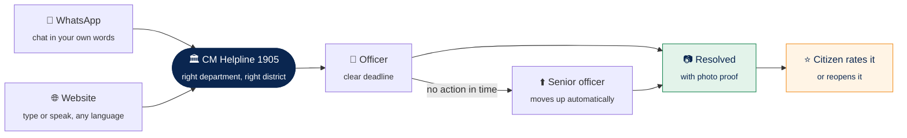
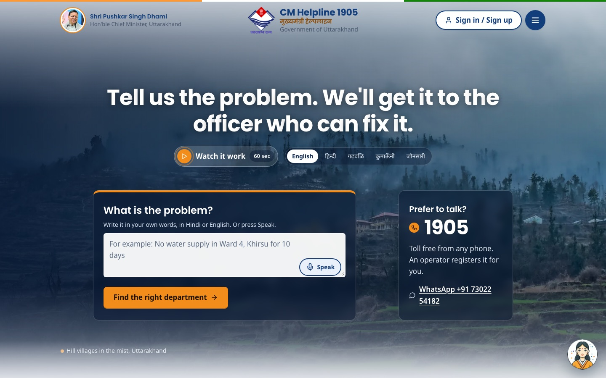
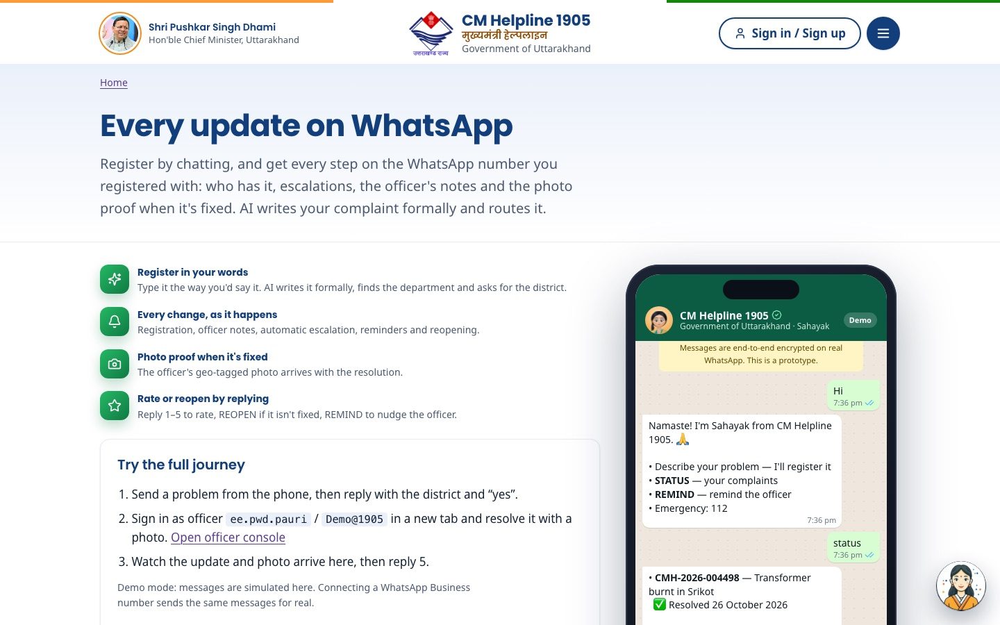
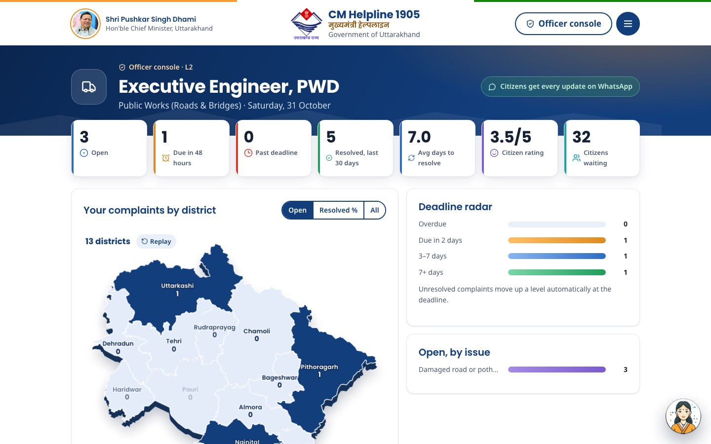
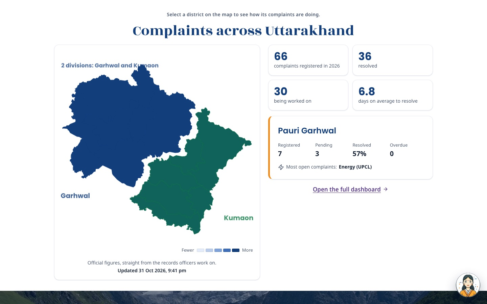
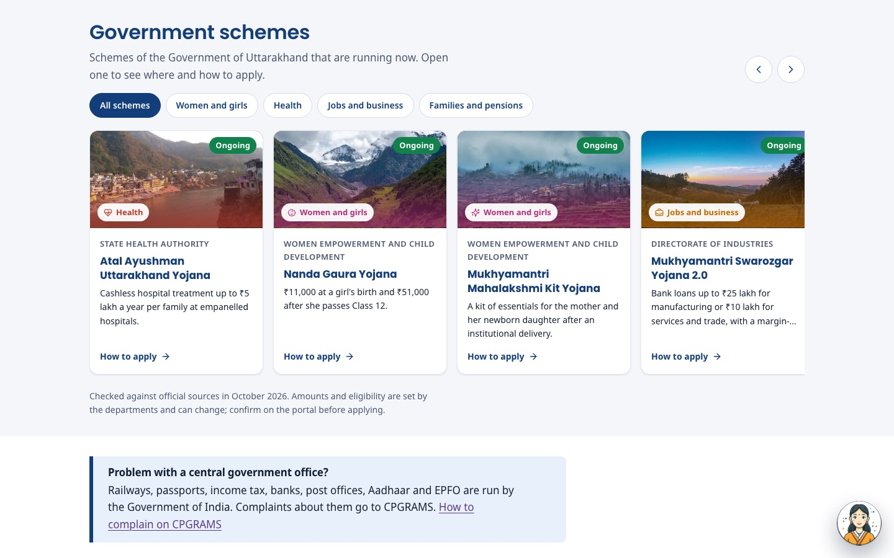
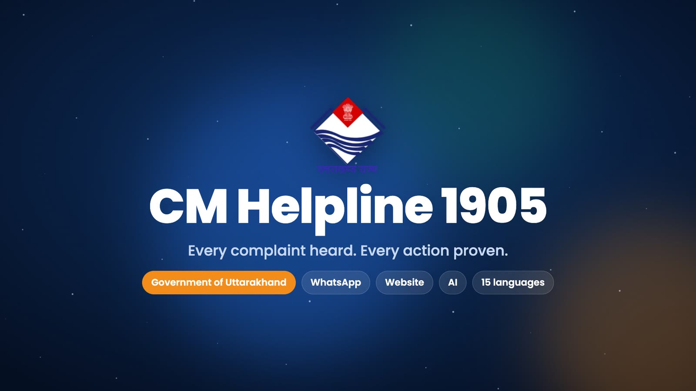

<div align="center">


# CM Helpline 1905

**Tell us the problem. We'll get it to the officer who can fix it.**

A citizen-first redesign of Uttarakhand's grievance helpline, built for the<br/>
Uttarakhand Citizen Digital Platforms hackathon.

<br/>

[](https://cm-helpline-uttarakhand.vercel.app)


<br/>


</div>

<br/>

## Why it matters

Every year, lakhs of people in Uttarakhand turn to CM Helpline 1905 for water, roads, electricity and pensions. Today, most of them:

- **have to know which department to pick** before they can even begin;
- **lose track of their complaint** once it's filed, with no idea who has it or by when;
- **have no proof** that anything was actually done before it's marked resolved.

This prototype keeps the helpline's existing rules and back-office flow, and rebuilds the experience around one simple promise: **describe it once, then always know who has it and by when.**

<br/>

## How a complaint travels



<br/>

## What's new

<table>
  <tr>
    <td width="33%" valign="top">
      <h3>💬 Report it your way</h3>
      Chat on <b>WhatsApp</b> or use the <b>website</b>. Type or simply speak, in Hindi, English or Hinglish.
    </td>
    <td width="33%" valign="top">
      <h3>🧭 No guesswork</h3>
      Describe the problem in plain words. The right department is suggested for you, and the complaint is written formally.
    </td>
    <td width="33%" valign="top">
      <h3>⏱️ Always know where it is</h3>
      See who holds your complaint and how many days they have. If time runs out, it moves up to a senior officer on its own.
    </td>
  </tr>
  <tr>
    <td valign="top">
      <h3>📷 Proof, not promises</h3>
      Officers can't close a complaint without a photo of the fix. You see the before and after, then rate the work or reopen it.
    </td>
    <td valign="top">
      <h3>🔔 Updates on WhatsApp</h3>
      Every step, from registration and officer notes to escalation and resolution, arrives on the number you registered with.
    </td>
    <td valign="top">
      <h3>🗣️ Your language</h3>
      15 languages, including <b>Garhwali</b>, <b>Kumaoni</b> and <b>Jaunsari</b>, with text read aloud and larger text and high-contrast options.
    </td>
  </tr>
  <tr>
    <td valign="top">
      <h3>🤝 "I face this too"</h3>
      Neighbours can join an existing complaint instead of filing duplicates, so officers see how many people are affected.
    </td>
    <td valign="top">
      <h3>👷 A desk for officers</h3>
      A clear queue with deadlines first, a district map, and quick notes turned into a proper report.
    </td>
    <td valign="top">
      <h3>📜 Schemes in one place</h3>
      Ongoing state schemes with where and how to apply, and a one-tap complaint if a benefit never arrived.
    </td>
  </tr>
</table>

<br/>

## A look inside

<table>
  <tr>
    <td width="50%"><p align="center"><sub><b>Home</b> · describe the problem, or call 1905</sub></p></td>
    <td width="50%"><p align="center"><sub><b>WhatsApp</b> · register and follow every update by chat</sub></p></td>
  </tr>
  <tr>
    <td><p align="center"><sub><b>Officer console</b> · deadlines, districts and the priority queue</sub></p></td>
    <td><p align="center"><sub><b>Open data</b> · live figures for every district</sub></p></td>
  </tr>
  <tr>
    <td colspan="2"><p align="center"><sub><b>Government schemes</b> · what's running now, and where to apply</sub></p></td>
  </tr>
</table>

<br/>

## Try it

Open **[cm-helpline-uttarakhand.vercel.app](https://cm-helpline-uttarakhand.vercel.app)**, or press **Watch it work** on the home page for a 90-second guided tour with voice-over.

| To see | Do this |
|---|---|
| **Register a complaint** | On the home page, type or speak the problem and press *Find the right department*. The one-time code appears on screen in the demo. |
| **Track one** | Go to *Track* and enter **CMH-2026-004512** with **9876543210**. |
| **WhatsApp** | Open `/whatsapp` and message the demo phone, for example *"No water in Khirsu for 4 days"*. |
| **Officer desk** | Sign in as an officer with **`ee.pwd.pauri`** and **`Demo@1905`**. |
| **Ask Sahayak** | Tap the assistant in the bottom corner and ask about any complaint or service. |

> [!NOTE]
> The live prototype runs on a free server that sleeps when idle. The first visit after a quiet spell can take up to a minute to wake up.

<br/>

## Run it locally

You'll need **Node.js 20** or newer.

```bash
npm install
npm run dev
```

The site opens at **http://localhost:5173**. Everything works out of the box with built-in sample data. To turn on the AI writing help, voice, WhatsApp and the Supabase database, copy `server/.env.example` to `server/.env` and fill in the keys you have.

<details>
<summary><b>Deploying</b></summary>
<br/>

The website is hosted on **Vercel** and the server on **Render**. Both settings files are included, and every push to `main` redeploys both.

| Part | Host | Settings |
|---|---|---|
| Website | Vercel | `vercel.json`: forwards `/api` to the server, so sign-in stays on one address |
| Server | Render | `render.yaml`: add the Supabase and AI keys when asked |

</details>

<details>
<summary><b>What's in the folder</b></summary>
<br/>

```
client/     The website (React)
  pages/        Home, Register, Track, My complaints, Officer, WhatsApp, Schemes, Demo …
  components/   Map, Sahayak assistant, photo proof, escalation clock …
server/     The server (Node.js)
  routes → controllers → services → data
supabase/   Database setup
docs/       Submission answers, audit of the current portal, design notes
```

</details>

<details>
<summary><b>How the rules work</b></summary>
<br/>

- The first officer has **15 days**, as set by government order. Each senior level then has its own deadline.
- If a deadline passes, the complaint **moves up automatically**, and the citizen is told on WhatsApp.
- A reminder can be sent **7 days** after filing, then every three days.
- Closing a complaint needs an **"after" photo**. The citizen can rate it, and a low rating or a reopen within **30 days** sends it one level higher.
- Up to **10 open complaints** per mobile number, as set by government order.

</details>

<br/>

## Further reading

| | |
|---|---|
| 📝 [**Submission**](docs/SUBMISSION.md) | Problem, solution, features and links for the hackathon form |
| 🔍 [**Audit**](docs/AUDIT.md) | What's wrong with the current portal, with evidence |
| 🎨 [**Design notes**](docs/DESIGN.md) | Colours, type, accessibility and the reasoning behind them |

<br/>

## Credits

Landscape photos are from Wikimedia Commons under their stated licences. The state emblem and the Chief Minister's portrait are works of the Government of Uttarakhand. District boundaries are from Census 2011 via DataMeet. Full credits are on the site's [Credits](https://cm-helpline-uttarakhand.vercel.app/credits) page.

<br/>

<div align="center">
<sub>
<b>A hackathon prototype, not the official portal.</b> For a real complaint, call <b>1905</b> or visit <a href="https://cmhelpline.uk.gov.in">cmhelpline.uk.gov.in</a>.<br/>
In an emergency, call <b>112</b>.
</sub>
<br/><br/>

</div>
